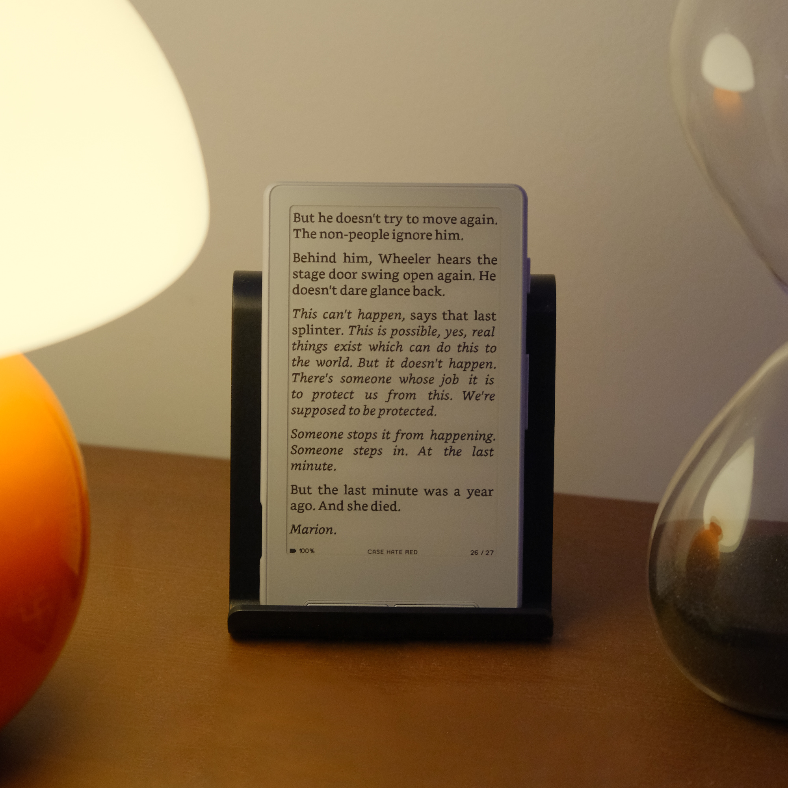

# EspOS firmware for the Xteink X4

This folder is the reader side of [EspOS](../README.md): a fork of
[CrossPoint Reader](https://github.com/crosspoint-reader/crosspoint-reader) that keeps its
reading engine and adds:

- a home screen and a sleep screen made of widgets (clock, calendar, weather, reading, books,
  news, markets, photos and more), laid out on the web;
- sync with an EspOS server: books sent from the web, device settings both ways, reading
  statistics, notifications, sleep-screen pictures;
- the sleep screen wakes on a timer to refresh its data and keep a minute clock, with quiet
  hours and a battery-saving level (`dash.save_pct`);
- setup over USB from the web app (WiFi, server address, device token), or linking with a code;
- packages: supports declarative faces, widgets and themes (data, no code), installed through the sync from
  the EspOS store or from an `.espk` file copied to `/EspOS/pkgs` on the card; a face can be used as the
  sleep screen (Apps > Installed packages; format in the EspOS docs, `s3desk/docs/profiles.md`);
- firmware updates over WiFi, with rollback.

EspOS code lives in `src/espos/` and `src/activities/apps/`; smaller changes touch
`lib/hal` (timer wake), `lib/GfxRenderer`, the home and sleep activities and the translations
(`STR_EO_*`). The device API is described in [docs/device-api.md](../docs/device-api.md).

## Build

Needs Python 3 and the pioarduino PlatformIO core 6.1.19 (stock PlatformIO 6.2 does not build
this tree):

```sh
pip install https://github.com/pioarduino/platformio-core/archive/refs/tags/v6.1.19.zip
git submodule update --init --recursive
cd firmware
pio run -e default                                  # .pio/build/default/firmware.bin
scripts/espos_bundle.sh default ../bundle         # bootloader, partitions, app + manifest.json
```

Add the bundle to your server with `./espos firmware add ../bundle -notes "…"`. The web app's
**Thiết bị** (Devices) page then installs it over USB, and linked readers are offered it as an update.

## Server address

A reader gets its server's address from the web installer, so the default build needs no
configuration. To also link a reader **with a code** (no cable), or to show your server's
address and QR code on the reader's setup and sleep screens, build it with your address. Put
it in `platformio.local.ini` next to `platformio.ini` (git ignores that file):

```ini
[env:default]
build_src_flags =
  '-DESPOS_DEFAULT_API="https://espos.example.com"'
```

| Flag | Default | |
|---|---|---|
| `ESPOS_DEFAULT_API` | empty | The EspOS server the reader calls (`/v1/...`). |
| `ESPOS_DEFAULT_WEB` | same as the API | The web app's address, used for QR codes and pairing links. Set it only when the web app is not served by the API host. |

A reader set up over USB keeps the address the installer gave it, whatever was built in.

## Firmware version

`FW_VERSION` in `src/espos/EspOSStore.h` (`espos-x4-X.Y.Z`). The server offers a bundle as an
update when its version is newer than the reader's.

---

The rest of this file is CrossPoint Reader's README.

# CrossPoint Reader

[](https://app.royalty.dev/crosspoint-reader/crosspoint-reader)

CrossPoint is open-source e-reader firmware - community-built, fully hackable, free forever. It's maintained by a growing community of developers and readers who believe your device should do what you want - not what a manufacturer decided for you.

### Now running on:

- **ESP32C3-based** Xteink X4 and X3.
- **ESP32S3-based** Xteink X4Pro and X4Classic, Seeed reTerminal Sticky, M5PaperMono, Metalio E-Ink 4, EEGOREAD A4 and Boox Picco.

Check [our Devices page](https://crosspointreader.com/devices) for the full list.



> If you're planning to buy an Xteink device, consider purchasing an **X3/X4 Developer Edition** through https://crosspointreader.com. CrossPoint receives a small share of each sale, helping fund development costs.

## What can CrossPoint do?

- **Reader engine**: EPUB 2/3 rendering with embedded-style option, image handling, hyphenation, kerning, adaptive table layouts, native CJK ruby annotations, chapter navigation, footnotes, bookmarks, dictionary lookups ([StarDict](docs/dictionary.md)), go-to-percent, auto page turn, orientation control, focus reading, KOReader progress sync and more.

- **Various formats**: native handling for `.epub`, `.xtc/.xtch`, `.txt`, and `.bmp`.

- **Touch reading**: follow EPUB links and look up words in the dictionary on touch-enabled devices.

- **Highlights and clippings**: highlight text in EPUBs and save excerpts as clippings. Use the reader menu on button devices, or hold a word and drag the selection handles on touch devices. Look up selected words or phrases in the dictionary. Enable Sync Clippings to sync saved excerpts through a compatible CrossPoint Sync server. See [Clippings and Highlights](USER_GUIDE.md#53-clippings-and-highlights).

- **Screenshots.**

- **Custom fonts**: install your favorite fonts on the SD card.

- **Tilt page turn (X3 and Sticky)**.

- **Bluetooth page turners**: pair a remote under Settings → Connectivity → Bluetooth Page Turner. Map short and long presses to page turns, chapter navigation, the reader menu, or clipping selection.

- **USB Drive mode (X4Pro)**: access the SD card as USB mass storage.

- **Library workflow**: indexed title/author search, recently-added and alphabetical views, multilingual grouping, folder browser, recent books, and SD-cache management.

- **Wireless workflows**:
  
  - File transfer web UI
  - EPUB Optimizer
  - Web settings UI/API (edit many device settings from browser)
  - WebSocket fast uploads
  - WebDAV handler
  - AP mode (hotspot) and STA mode (join existing Wi-Fi), both with QR helpers
  - Calibre wireless connect flow
  - OPDS browser with saved servers (up to 8), search, pagination, and direct download; hold Back for one second and release in a catalog to return to the main menu
  - OTA update checks and installs from GitHub releases

- **Customization**: night mode, multiple themes (Classic, Lyra, Lyra Extended, RoundedRaff), sleep screen modes including transparent overlays, front/side button remapping, status bar controls, power-button behavior, refresh cadence, and more.

- **Localization**: 34 UI languages and counting, including CJK font fallback and RTL support.

- **SD card plugins**: install plugins for book catalogs, downloads, and tools in the device's web interface. Enable Plugins under Settings → Connectivity to show them on Home. On-device plugins use existing firmware screens and operations. JavaScript runs in a browser on your phone or computer, and its page must stay open while it works. Plugins follow [CrossPoint's reading-focused scope](SCOPE.md#out-of-scope). See the [plugin guide](docs/sd-plugins.md).

### Coming soon:

- More themes.

- Much more! stay tuned.

---

## USB-locked devices (Xteink Unlocker)

Some Xteink units purchased from third-party stores (e.g. AliExpress) ship with USB flashing locked from the factory.
If your device is locked, you will need to use the **Xteink Unlocker** tool available at
https://crosspointreader.com/#unlock-tool before you can flash CrossPoint.

**You do not need this tool if you bought your device directly from xteink.com.** Those units are not locked.

**Not sure if your device is locked?** Power it on, connect the USB-C cable, and try flashing via the web flasher first (see
[Install firmware](#install-firmware) below). If the browser's serial device picker does not show your device, try a different
USB port or browser before assuming the device is locked. Only reach for the unlocker if the device still doesn't appear.

> ### ⚠️ WARNING: READ THIS BEFORE USING THE UNLOCKER ⚠️
> 
> **The only officially supported firmwares in the unlock tool are CrossPoint and CrossInk.**
> 
> Flashing any other firmware on a USB-locked device may **permanently brick the device** or leave it **permanently
> stuck on that firmware with no recovery path**. Once USB flashing is re-locked, your only way back is via OTA, and if
> the firmware you flashed doesn't support OTA, **there is no way out**.

## Install firmware

### Web installer (recommended)

1. Connect your device to your computer via USB-C and wake/unlock the device
2. Go to https://crosspointreader.com/#flash-tools, select your device (X3, X4, Xteink X4Pro, Seeed reTerminal Sticky, or M5PaperMono), and choose an official CrossPoint release.

### Web installer (specific version)

1. Connect your device to your computer via USB-C and wake/unlock the device
2. Download the firmware file for your device from [Releases](https://github.com/crosspoint-reader/crosspoint-reader/releases), or compile yourself.
3. Go to https://crosspointreader.com/#flash-tools, select your device, click "Custom .bin" and upload the firmware file.

### Revert to Official Firmware

To revert to the official firmware, you can also flash the latest official firmware using https://crosspointreader.com/#flash-tools.

### Command line

1. Install [`esptool`](https://github.com/espressif/esptool):

```bash
pip install esptool
```

2. Download the firmware file for your device from the [releases page](https://github.com/crosspoint-reader/crosspoint-reader/releases).
3. Connect your device via USB-C.
4. Find the device port. On Linux, run `dmesg` after connecting. On macOS:

```bash
log stream --predicate 'subsystem == "com.apple.iokit"' --info
```

5. Flash an X3 or X4:

```bash
esptool.py --chip esp32c3 --port /dev/ttyACM0 --baud 921600 write_flash 0x10000 /path/to/firmware.bin
```

   Flash an Xteink X4Pro, Seeed reTerminal Sticky, or M5PaperMono:

```bash
esptool.py --chip esp32s3 --port /dev/ttyACM0 --baud 921600 write_flash 0x10000 /path/to/firmware.bin
```

### Manual

See [Development quick start](#development-quick-start) below.

---

## Custom SD-card fonts

On devices with external RAM enabled in CrossPoint, copy `.ttf`, `.otf`, or `.ttc` files to the SD card and select them as reader fonts. Put one file in `/fonts/` or `/.fonts/`, or put one family's files in a subfolder. See the [SD card font guide](./docs/sd-card-fonts.md) for the folder layout and styles.

On other devices, convert the font to `.cpfont` first. `.cpfont` files also work on devices with external RAM enabled and have better performance. No firmware reflash is needed to add fonts.

To make `.cpfont` files:

1. Go to https://crosspointreader.com/fonts and open the "SD-card font builder" form.
2. Upload up to four styles (regular, bold, italic, bold-italic), set the family name, point sizes, and Unicode range.
3. Download the generated `.cpfont` files.
4. Copy them to your SD card under `/fonts/YourFont/` (or `/.fonts/YourFont/` to hide the folder).
5. Select the font on the device from the font settings.

Conversion runs the firmware repo's `lib/EpdFont/scripts/fontconvert_sdcard.py` script unmodified, so output matches a local host build.

---

## Documentation

- [User Guide](./USER_GUIDE.md)
- [Web server usage](./docs/webserver.md)
- [Web server endpoints](./docs/webserver-endpoints.md)
- [Project scope](./SCOPE.md)
- [Contributing docs](./docs/contributing/README.md)
- [Touch and UI development](./docs/contributing/touch-and-ui.md) - how to build new screens on the FreeInkUI activity bases (UiListActivity and friends), plus build envs for the non-Xteink touch devices

---

## Development quick start

### Prerequisites

- [pioarduino PlatformIO Core](https://github.com/pioarduino/platformio-core) or [VS Code + pioarduino IDE](https://github.com/pioarduino/pioarduino-vscode-ide)
- Python 3.8+
- `clang-format` 21
- USB-C cable supporting data transfer

### Setup

```bash
git clone --recursive https://github.com/crosspoint-reader/crosspoint-reader
cd crosspoint-reader

# if cloned without --recursive:
git submodule update --init --recursive
```

### Nix/NixOS

Nix/NixOS users can enter the development shell with either `nix develop` (flakes) or `nix-shell`:

```bash
nix develop -f nix
# or
nix-shell nix
```

To flash a connected ESP32-C3 device, enable PlatformIO's udev rules in your NixOS configuration:

```nix
services.udev.packages = with pkgs; [ platformio-core.udev ];
```

After rebuilding the system configuration, reconnect the device or reload udev rules.

### Build / flash / monitor

```bash
pio run --target upload
```

### Contributor pre-PR checks

```bash
./bin/clang-format-fix
pio check -e default
pio run -e default
```

### Debugging

After flashing the new features, it’s recommended to capture detailed logs from the serial port.

First, make sure all required Python packages are installed:

```python
python3 -m pip install pyserial colorama matplotlib
```

After that run the script:

```sh
# For Linux
# This was tested on Debian and should work on most Linux systems.
python3 scripts/debugging_monitor.py

# For macOS
python3 scripts/debugging_monitor.py /dev/cu.usbmodem2101
```

Minor adjustments may be required for Windows.

---

## Internals

CrossPoint Reader is pretty aggressive about caching data down to the SD card to minimise RAM usage. The ESP32-C3 only has ~380KB of usable RAM, so we have to be careful. A lot of the decisions made in the design of the firmware were based on this constraint.

### Data caching

The first time chapters of a book are loaded, they are cached to the SD card. Subsequent loads are served from the
cache. This cache directory exists at `.crosspoint` on the SD card. The structure is as follows:

```text
.crosspoint/
├── epub_<hash>/         # one directory per book, named by content hash
│   ├── progress.bin     # reading position (chapter, page, etc.)
│   ├── cover.bmp        # generated cover image
│   ├── book.bin         # metadata: title, author, spine, TOC
│   ├── css_rules.cache  # parsed CSS rule cache
│   ├── img_*            # rendered image cache files
│   └── sections/        # per-chapter layout cache
│       ├── 0.bin
│       ├── 1.bin
│       └── ...
├── settings.json        # device settings
├── state.json           # resume/runtime state
└── recent.json          # recent books list
```

Removing `/.crosspoint` clears all cached metadata and forces a full regeneration on next open. Book deletes, overwrites, and moves done through the firmware or web UI clear or re-key matching caches; manual SD-card edits may leave stale cache directories behind.

For more details on the internal file structures, see the [file formats document](./docs/file-formats.md).

---

## Contributing

Contributions are welcome. If you're new to the codebase, start with the [contributing docs](./docs/contributing/README.md). For things to work on, check the [ideas discussion board](https://github.com/crosspoint-reader/crosspoint-reader/discussions/categories/ideas) — leave a comment before starting so we don't duplicate effort.

Everyone here is a volunteer, so please be respectful and patient. For governance and community expectations, see [GOVERNANCE.md](./GOVERNANCE.md).

---

## Community forks

One of the best things about open source is that anyone can take the code in a different direction. If you need something outside CrossPoint's [scope](./SCOPE.md), check out the community forks:

- [CrossInk](https://github.com/uxjulia/CrossInk) — UX focused with minimal reading stats and broader customizations for the reading experience.

- [papyrix-reader](https://github.com/bigbag/papyrix-reader) — Adds FB2 and MD format support. Actively maintained with Arabic script support. Custom themes.

- [inx](https://github.com/obijuankenobiii/inx) — Completely reimagines the user interface with tabbed navigation.

- [Witch(hunt) Reader](https://github.com/jpirnay/witchhunt-reader) — More faithful CSS styling and background work for slightly snappier interaction. Weather information panel. Markdown support.

**Note:** Many of these features will make their way into CrossPoint over time. Each project chooses its own priorities and tradeoffs.

Want to build your own device? Be sure to check out the [Silkscreen](https://silkscreenreader.com) project or [OnePage Reader](https://github.com/MoveCall/onepage-reader).

---

CrossPoint Reader is **not affiliated with Xteink or any device manufacturer**.
